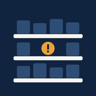
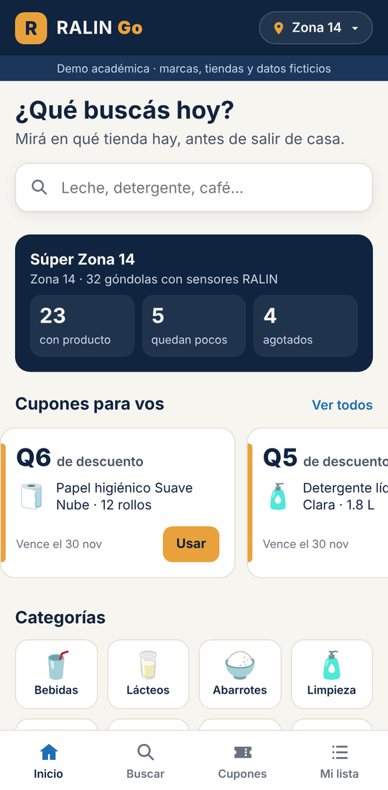
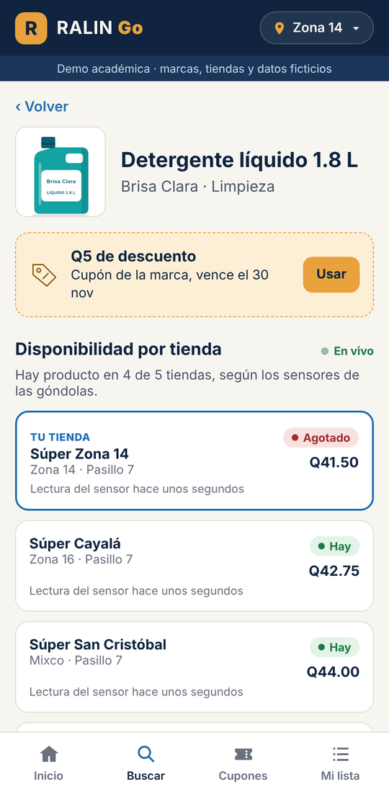
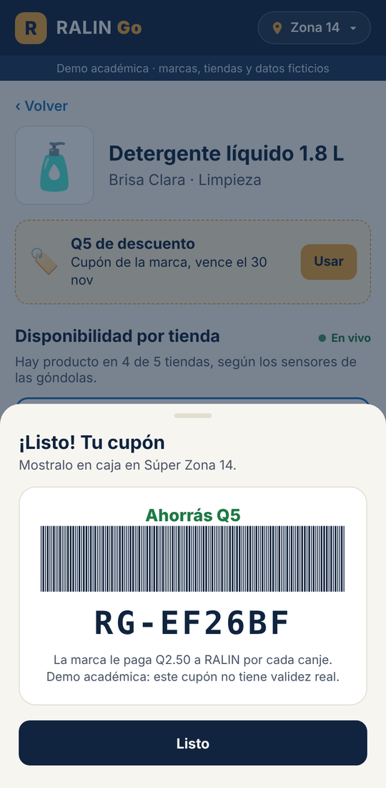
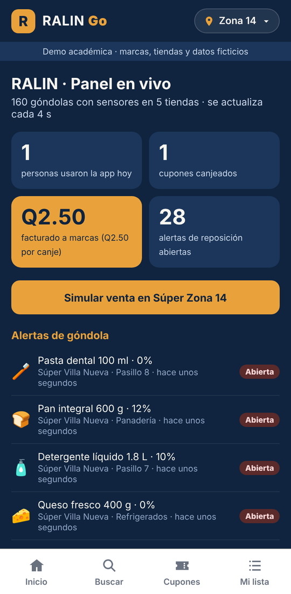
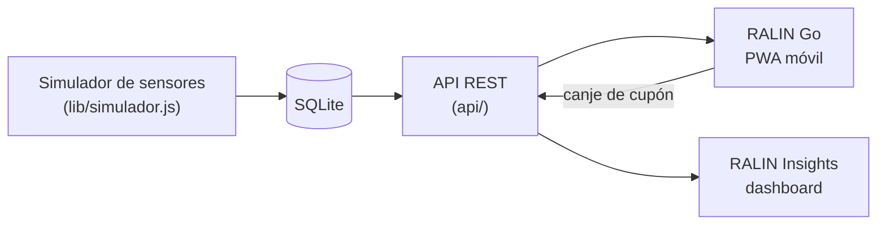
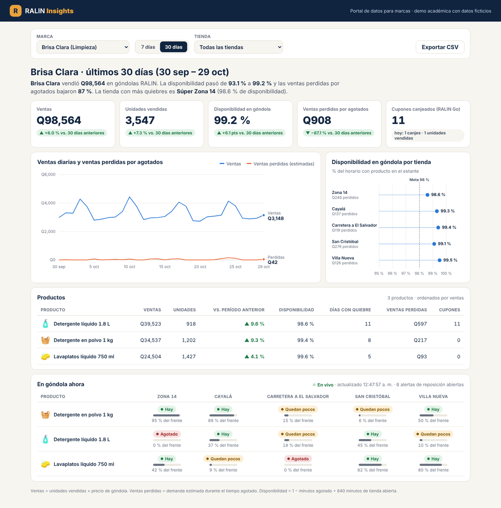

<p align="center">
  
</p>

<h1 align="center">RALIN Go</h1>

<p align="center">
  Disponibilidad de productos en tiempo real, cupones de marcas y reportes de góndola.<br>
  Prototipo funcional del ecosistema de estanterías inteligentes RALIN.
</p>

<p align="center">
  <a href="https://github.com/TU-USUARIO/ralin-go/actions/workflows/pruebas.yml"></a>
  
  
  
  
  
</p>

<p align="center">
  
  
  
  
</p>

---

## Contenido

- [Descripción](#descripción)
- [Características](#características)
- [Arquitectura](#arquitectura)
- [Instalación local](#instalación-local)
- [Despliegue en Render](#despliegue-en-render)
- [RALIN Insights](#ralin-insights)
- [API](#api)
- [Base de datos](#base-de-datos)
- [Pruebas](#pruebas)
- [Contexto académico](#contexto-académico)
- [Licencia](#licencia)

## Descripción

RALIN propone estanterías con sensores de peso y etiquetas electrónicas que miden en tiempo real cuánto producto queda en cada góndola. Ese mismo dato se aprovecha de tres formas:

| Cliente | Producto | En este repositorio |
| --- | --- | --- |
| Supermercado | Alertas de reposición y precios sincronizados | Simulador de sensores y alertas |
| Marcas | **RALIN Insights**: reportes de ventas, disponibilidad y quiebres | Dashboard en `/insights` |
| Consumidor | **RALIN Go**: qué tienda tiene el producto, con cupones | App web instalable |

> **Nota:** las marcas, tiendas, precios e historial son ficticios y se generan al iniciar el servidor.

## Características

**App RALIN Go (PWA)**
- Búsqueda por producto, marca o categoría, sin importar las tildes.
- Estado por tienda (*Hay / Quedan pocos / Agotado*) con la hora de la última lectura del sensor, actualizado cada 8 s. Nunca muestra unidades exactas.
- **Guía en el pasillo** (*shop to light*): desde el detalle de un producto, la app hace parpadear el LED de su etiqueta electrónica en un color asignado a cada cliente y mide la latencia de punta a punta (meta: menos de 2 s).
- Cupones patrocinados por marcas, con código de canje y un solo canje por dispositivo.
- Lista de compras que recomienda la tienda donde se encuentran más productos.
- Panel en vivo con usuarios, canjes, facturación a marcas y alertas de reposición.
- Ilustraciones vectoriales propias para cada producto, con el empaque y los colores de su marca.
- Instalable en Android e iOS. Funciona sin conexión gracias al *service worker*.

**RALIN Insights**
- Indicadores de ventas, unidades, disponibilidad, ventas perdidas y cupones, comparados con el período anterior.
- Serie diaria de ventas contra ventas perdidas, y disponibilidad por tienda frente a una meta.
- Tabla de productos exportable a CSV y vista en vivo del nivel de cada góndola.

**Backend**
- API REST con Node.js (`node:http`) y base de datos SQLite (`node:sqlite`), sin dependencias externas.
- Simulador de sensores: genera ventas, crea alertas cuando una góndola baja del 15 % y simula la reposición.

## Arquitectura



```
ralin-go/
├── server.js              servidor HTTP: API + archivos estáticos
├── api/
│   ├── rutas.js           endpoints de la app
│   └── insights.js        endpoints de reportes para marcas
├── db/
│   ├── schema.sql         tablas, índices y vista de disponibilidad
│   ├── database.js        conexión e inicialización
│   └── seed.js            datos de demostración e historial de 60 días
├── lib/
│   ├── simulador.js       simulador de sensores de peso
│   ├── gateway.js         simulador del gateway de tienda (guía en el pasillo)
│   ├── qr-svg.js          generador de códigos QR en SVG
│   └── qr/                codificador QR (MIT, Kazuhiko Arase)
├── public/
│   ├── index.html         app RALIN Go (app.js, styles.css)
│   ├── insights.html      dashboard (insights.js, insights.css)
│   ├── presentar.html     pantalla con código QR para compartir la app
│   ├── img/               ilustraciones vectoriales de productos y categorías
│   └── manifest.webmanifest, sw.js, icons/
├── scripts/ilustraciones.js  genera las ilustraciones SVG (npm run ilustraciones)
├── test/api.test.js       pruebas automatizadas
├── docs/capturas/         imágenes del README
└── render.yaml            configuración de despliegue
```

## Instalación local

**Requisito:** Node.js 22.13 o superior (`node -v`). No hay que instalar paquetes.

```bash
git clone https://github.com/TU-USUARIO/ralin-go.git
cd ralin-go
npm start
```

| Dirección | Contenido |
| --- | --- |
| http://localhost:3000 | App RALIN Go |
| http://localhost:3000/insights | Dashboard RALIN Insights |
| http://localhost:3000/presentar | Código QR de la app y contadores en vivo |
| http://localhost:3000/api | Lista de endpoints |

| Comando | Acción |
| --- | --- |
| `npm start` | Inicia el servidor (puerto `PORT`, por defecto 3000) |
| `npm run seed` | Reinicia la base de datos con los datos de demostración |
| `npm test` | Ejecuta las pruebas |
| `npm run ilustraciones` | Regenera las ilustraciones SVG de productos y categorías |

Variables de entorno opcionales: `PORT`, `DB_PATH` (ruta del archivo SQLite) y `SIMULADOR=apagado`.

## Despliegue en Render

Para abrir la app desde un teléfono y poder instalarla, el servidor debe estar publicado en internet con HTTPS. Render ofrece ambas cosas en su plan gratuito.

1. Subí el repositorio a GitHub.
2. En [render.com](https://render.com), elegí **New → Blueprint** y seleccioná el repositorio. Render lee `render.yaml` y configura el servicio.
   - Si preferís hacerlo a mano, elegí **New → Web Service** con Runtime **Node**, build `npm install`, start `npm start`, plan **Free** y la variable `NODE_VERSION=22`.
3. Cuando el servicio diga **Live**, quedan disponibles:
   - App: `https://TU-SERVICIO.onrender.com`
   - Dashboard: `https://TU-SERVICIO.onrender.com/insights`
   - Código QR para compartir: `https://TU-SERVICIO.onrender.com/presentar`

Cada `git push` a `main` vuelve a publicar el servicio automáticamente.

**Consideraciones del plan gratuito:**
- El servicio se suspende tras 15 minutos sin tráfico, y la siguiente visita tarda cerca de un minuto en reactivarlo.
- El disco no es persistente: la base de datos se regenera en cada reinicio.

**Instalar la app en el teléfono:**
- **Android (Chrome):** botón *Instalar* en la pantalla de inicio de la app, o menú ⋮ → *Instalar app*.
- **iPhone (Safari):** *Compartir* → *Agregar a inicio*.

## RALIN Insights

<p align="center"></p>

El dashboard lo sirve el mismo servidor que la app: no se instala aparte. Cada marca ve solo sus productos.

**Cómo se calculan los indicadores:**

| Indicador | Cálculo |
| --- | --- |
| Ventas | unidades vendidas × precio de góndola |
| Disponibilidad | 1 − minutos agotado ÷ 840 minutos de tienda abierta |
| Ventas perdidas | demanda estimada durante el tiempo agotado × precio |

El historial abarca 60 días. Los 30 días anteriores al período actual representan la operación antes de instalar RALIN, para poder comparar.

## API

Base: `/api`. Las respuestas son JSON. La cabecera opcional `X-Dispositivo` identifica al dispositivo de forma anónima.

| Método | Ruta | Descripción |
| --- | --- | --- |
| GET | `/api/salud` | Estado del servidor |
| GET | `/api/tiendas` | Tiendas con conteo de productos disponibles, con poco stock y agotados |
| GET | `/api/categorias` | Categorías |
| GET | `/api/productos?q=&categoria=&tienda=` | Búsqueda con estado en la tienda seleccionada |
| GET | `/api/productos/:id` | Detalle y disponibilidad por tienda |
| GET | `/api/disponibilidad?productos=1,2,3` | Tiendas ordenadas por cobertura de una lista |
| GET | `/api/cupones` | Cupones activos y canjes del dispositivo |
| POST | `/api/cupones/:id/canjear` | Canjea un cupón: `{ "tienda_id": 1 }` |
| GET | `/api/alertas?abiertas=1&limite=10` | Alertas de reposición |
| GET | `/api/metricas` | Métricas del panel en vivo |
| POST | `/api/simular/venta` | Simula una venta: `{ "tienda_id": 1, "producto_id": 18, "unidades": 5 }` |
| POST | `/api/guia` | Hace parpadear la etiqueta ESL de un producto: `{ "tienda_id": 2, "producto_id": 18 }` |
| POST | `/api/guia/:id/latencia` | Registra la latencia medida en el teléfono: `{ "ms": 840 }` |
| POST | `/api/guia/:id/encontrada` | Marca que el cliente encontró el producto |
| GET | `/api/qr.svg?texto=URL` | Código QR en SVG |
| GET | `/api/insights/marcas` | Marcas disponibles |
| GET | `/api/insights/resumen?marca=&dias=7\|30&tienda=` | Indicadores, serie diaria, tiendas y productos |
| GET | `/api/insights/gondolas?marca=` | Nivel actual de cada góndola de la marca |

```bash
curl http://localhost:3000/api/productos/18
```

## Base de datos

| Tabla | Contenido |
| --- | --- |
| `tiendas` | 5 sucursales (urbanas y suburbanas) |
| `categorias`, `productos` | 8 categorías y 32 productos con peso unitario |
| `inventario` | Lectura actual de cada góndola: capacidad, unidades, precio y pasillo |
| `lecturas` | Historial de lecturas del sensor de peso |
| `ventas_diarias` | Resumen diario por góndola: unidades, ventas perdidas, minutos agotado y canjes |
| `alertas` | Avisos de reposición cuando la góndola baja del 15 % |
| `cupones`, `canjes` | Cupones patrocinados y su historial de canje |
| `guias` | Cada guía al pasillo: etiqueta, color del LED y latencia del gateway y de la app |
| `dispositivos` | Identificadores anónimos de los dispositivos que usan la app |
| `v_disponibilidad` (vista) | Convierte unidades en *Hay / Quedan pocos / Agotado* |

## Pruebas

```bash
npm test
```

Las pruebas usan el ejecutor nativo de Node.js (`node:test`) con una base en memoria, y corren en GitHub Actions en cada `push`.

## Contexto académico

Proyecto final del curso de **Microeconomía**, Ingeniería en Sistemas, Universidad Mariano Gálvez de Guatemala, 2026.

**Equipo:** Darío Rabe · Richard Pernillo · Libbny Medrano · Holcen Ajín · Cristian Cano

## Licencia

Distribuido bajo la licencia [MIT](LICENSE). El codificador QR en `lib/qr/` es de Kazuhiko Arase, también bajo licencia MIT.
